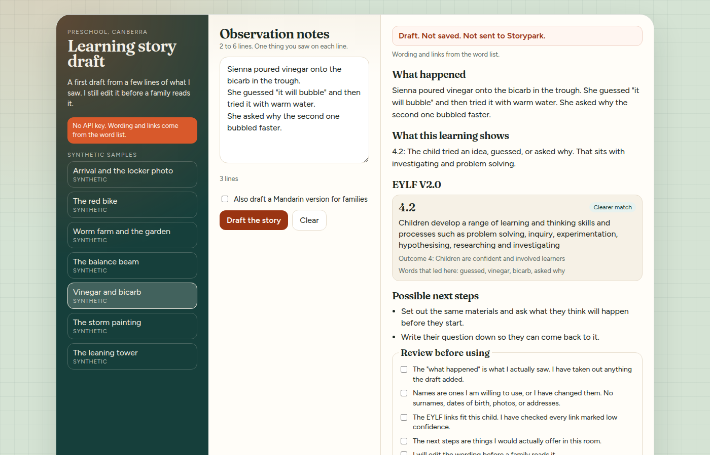
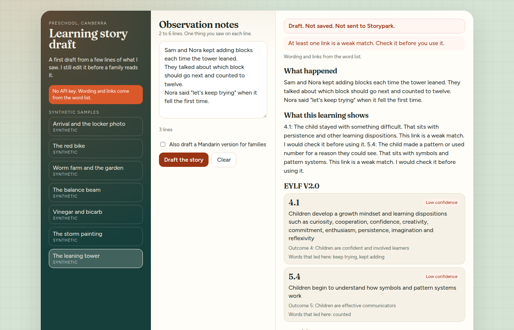

# Learning story draft

I teach preschool in Canberra. After a day in the room, the learning stories still have to be written, and that writing takes a long time. I wanted to see if a small tool could give me a first draft I would still edit.

## What it does

I paste 2 to 6 lines of what I saw, or open a synthetic sample. It drafts:

- what happened
- what learning it shows
- a link to the EYLF V2.0 outcomes, with the sub-outcome number (4.2 and so on)
- a short note on possible next steps
- a flag when a link is only a weak match

I can also ask for a Mandarin version for families. I would still rewrite that. The Chinese is a working translation, not an official EYLF text. The framework itself is in English.

There is a checklist to read before I use any of it. The page says draft. It does not post to Storypark. I have not connected Storypark. Notes I paste are not saved.

With no API key, a fixed word list picks the links and fills a plain draft. If `OPENAI_API_KEY` is set, the model writes the paragraphs. The outcome sentences still come from the framework text below, not from the model. If the model cites an outcome the word list did not choose, the draft falls back to the plain wording.

## Do not paste real children

The samples are made up. They are labelled synthetic. Children have names I invented, or are called Child A. Do not paste surnames, dates of birth, photos, addresses, or anything else that identifies a child or a family. If you try your own notes, change the names first.

The server does not store the notes. The draft stays in the browser tab until you clear it or leave the page.

## A small check on the word list

I wrote 22 synthetic notes and marked the sub-outcome I would cite for each one. `npm run eval` runs the word list over `eval/synthetic-notes.json`.

Exact sub-outcome: 21/22 (95%)
Outcome (1-5): 21/22 (95%)
In the top 3 scores: 21/22 (95%)
4 of 21 exact matches were still low confidence.
No link scored high enough: 1/22.

The miss was 1.4 -> none (1). That note is a child going quiet when a tower falls, and another child moving in beside him. I would call it care. The list looks for words like upset, crying, or sat with, and none of those are in the note, so it attaches nothing. If the care is only in the gesture, this tool misses it.

Two of the low-confidence matches had another outcome close behind. On a bike fall, 1.4 (kneeling beside a hurt friend) also scored 3.3 (the helmet) and 3.2 (fell off). On a leaning block tower, 4.1 (keep trying) also scored 5.4 (they counted) and 5.1 (they talked). A short note about painting "on his own", and a dough-table conversation written as "went back and forth", stayed on the outcome I had marked, but the score was thin, so those are flagged too.

This is a small set. I wrote both the notes and the labels. The samples in the app are part of the same 22. I did not keep a separate test set. A lot of the notes use fairly direct language, so 21/22 is not a claim about real observations, and it is not a validated assessment.

## Framework text

The outcome and sub-outcome sentences are copied from:

Australian Government Department of Education [AGDE] (2022). _Belonging, Being and Becoming: The Early Years Learning Framework for Australia (V2.0)._ Australian Government Department of Education for the Ministerial Council.

<https://www.acecqa.gov.au/sites/default/files/2023-01/EYLF-2022-V2.0.pdf>

That PDF is the official V2.0 text. I checked the sentences against it. The document lists the sub-outcomes as bullet points, not as 1.1 or 4.2. The numbers are the order they appear, which is how I cite them when I document. I have not rewritten the sentences. Some of them changed from the 2009 framework, especially under outcomes 2, 3 and 4, so this tool uses the 2022 wording.

The Mandarin lines are mine, for families. They are not an official translation.

## Screenshots

From synthetic samples, no API key.





## How to run

Node 20 or newer.

```bash
npm install
npm run dev
```

Open http://localhost:5173. The API is on port 8787.

```bash
npm test
npm run lint
npm run build
npm run eval
```

```bash
cp .env.example .env
```

Put a key in `.env` if you want the model to write the paragraphs. Don't commit it.

`npm start` after `npm run build` serves the page and the API on port 8787.

## Not done yet

- I have not connected Storypark. I don't want these notes to leave the page.
- The word list misses learning that is real but written in other words. That is why low-confidence links are marked, and why one note came back with no link.
- Without a key, the Mandarin draft is a frame around the notes, not a full translation of every sentence.
- I would still rewrite a draft before a family sees it.
